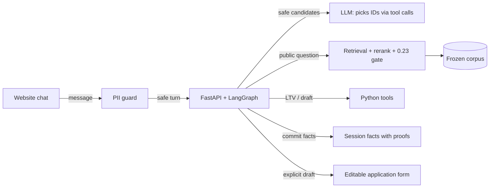

# Grounded Mortgage Assistant

A mortgage chat assistant that answers only from reviewed, cited sources, calculates loan-to-value through a tool call, and turns a conversation into a pre-filled, editable application draft. Built as an AI Engineering capstone on Lendo's mortgage page (Lendo is a Swedish loan comparison service).

**Demo video (3:32):** [youtu.be/_Z884yL753A](https://youtu.be/_Z884yL753A)

- **Grounded answers:** two-view BGE-M3/FAISS retrieval, a local cross-encoder reranker and a calibrated relevance gate. The LLM only selects evidence IDs; the server renders reviewed extracts with citations, or says the corpus does not cover the question.
- **Tool calls, not model arithmetic:** the LLM answers each turn with a schema-validated tool call; Python performs the LTV calculation with `Decimal` on amounts the customer actually typed.
- **Customer control:** facts live in session memory with proofs; a draft is prepared only on an explicit request and fills an editable form, never a submission.
- **Privacy first:** a local PII detector runs before any model call and fails closed; amounts are masked before the model sees the turn.
- **Observability:** an engineering console at `/inspect` shows each turn as a trace (guardrail, routing, retrieval, LLM, state) with tokens, latency and cost.
- **Provider choice:** local Qwen3.5-9B through an OpenAI-compatible endpoint, or OpenAI (`gpt-4.1` by default), fixed at startup with no fallback.

## Provenance

This history is a curated re-creation. The project was developed from 29 to 31 October 2026 in a private repository that also held Lendo-owned content, which cannot be published. These commits were assembled on 31 October 2026 from that final state, in dependency order; they do not reproduce the original sequence. [docs/experiments/timeline.md](docs/experiments/timeline.md) records when each experiment happened.

Not included: the Lendo website frontend the chat runs in (proprietary), the corpus prepared in an earlier capstone phase (Lendo-owned), and the raw evaluation evidence. Published results are aggregate counts and case IDs with pass/fail, never corpus text. Lendo has consented to publishing the code.

## Architecture



Interactive diagrams: [overview](docs/architecture/overview.html) and [detailed](docs/architecture/detailed.html) (open in a browser), with notes in [overview.md](docs/architecture/overview.md) and [detailed.md](docs/architecture/detailed.md). The full write-up is the [technical documentation](docs/technical-documentation.md); the design one-pager is [capstone-one-ish-pager.pdf](docs/capstone-one-ish-pager.pdf).

```text
src/grounded_mortgage_assistant/
  app.py, config.py   FastAPI app (chat, sources, forget, reset, console) and environment settings
  guardrails/         Private ingress parsing, amount masking, PII detector client
  llm/                Provider selection, tool schemas, context budgeting, turn interpretation
  rag/                Two-view retrieval, relevance gate, citation rendering
  workflow/           LangGraph interpret-then-act graph
  state/              Proof-backed session memory, replay, reset and expiry
  tools/              Decimal LTV and the refinance draft
  console/static/     Engineering console at /inspect
services/pii/         Isolated local PII detector (own locked environment)
tests/                Unit and API tests; run without the corpus or a model
data/sample/          20 synthetic mortgage records
docs/                 Technical documentation, architecture, results and experiments
```

## Quickstart: tests

Python 3.14. The tests need neither the corpus nor a model: API tests use the synthetic sample, and tests of the private bundle skip with a reason.

```sh
python3.14 -m venv .venv
.venv/bin/python -m pip install -r requirements.lock
.venv/bin/python -m pytest -q
.venv/bin/python -m ruff check .
```

## Running the backend

The backend needs three things: a frozen corpus bundle at `DATA_DIR`, an LLM, and the local PII detector ([services/pii/README.md](services/pii/README.md)).

| Setting | Purpose |
| --- | --- |
| `DATA_DIR` | Corpus root (default `data/corpus`, ignored by Git) |
| `LOCAL_TOKENIZER_PATH` | Local Qwen tokenizer for exact context budgeting; required for real model calls |
| `LLM_PROVIDER` | `local` (default, OpenAI-compatible endpoint at `127.0.0.1:8011`) or `openai` |
| `OPENAI_API_KEY`, `OPENAI_MODEL` | For `openai`; the model defaults to `gpt-4.1` |
| `OPENAI_REASONING_EFFORT` | GPT-5 models only; `none` is the only effort Chat Completions accepts with tools |
| `CORPUS_NAME` | Organisation named in user-facing answers (default none) |

```sh
DATA_DIR=/path/to/corpus LOCAL_TOKENIZER_PATH=/path/to/Qwen3.5-9B-MLX-4bit \
  PYTHONPATH=src HF_HUB_OFFLINE=1 TRANSFORMERS_OFFLINE=1 \
  .venv/bin/python -m uvicorn grounded_mortgage_assistant.app:create_app --factory --host 127.0.0.1 --port 8099
```

Then send turns to `POST /api/chat` and open the console at `http://127.0.0.1:8099/inspect`. Embeddings (`BAAI/bge-m3`) and the reranker (`BAAI/bge-reranker-v2-m3`) load from the Hugging Face cache at pinned revisions; download them once without the offline flags.

### Retrieval without the private corpus

A fresh clone cannot answer product questions yet: the reference bundle is Lendo-owned. A loader that turns [data/sample/records.jsonl](data/sample/records.jsonl) into a bundle is planned. Until then, building one takes four steps:

1. Download `BAAI/bge-m3` and `BAAI/bge-reranker-v2-m3`.
2. Embed each record's question and answer with BGE-M3 and build a FAISS HNSW index.
3. Write the records, vectors, index and a SHA-256 manifest in the layout `validate_frozen_bundle` in [rag/retrieval.py](src/grounded_mortgage_assistant/rag/retrieval.py) reads.
4. Replace the pinned hashes and record count in that function with your manifest's values, and point `DATA_DIR` at the bundle.

The LTV, draft and privacy logic never uses retrieval, but the app loads the bundle at startup; letting it start without one is part of the loader work.

## Results

All numbers are on exposed development cases, not an unseen acceptance set. Details and per-case outcomes: [docs/experiments](docs/experiments/README.md) and [docs/results](docs/results).

| Study | Result |
| --- | --- |
| [Relevance gate](docs/experiments/relevance-gate.md) | Threshold 0.23 keeps 142/146 supported questions and rejects 7/9 unsupported |
| [Reranker comparison](docs/experiments/reranker-comparison.md) | Local BGE 129/149 complete-support cases, Cohere 131/149 with regressions; local BGE kept |
| [Earlier retrieval study](docs/experiments/retrieval-study.md) | Whole-Q&A BGE-M3 dense 26/28 against sentence-chunk E5-small 25/28 |
| Retrieval parity | 159/159 exact matches after the framework port |
| Browser suites (real UI) | Journey 16/16 and 20-question suite 19/20 on both local Qwen and OpenAI gpt-4.1 |
| [Model comparison](docs/experiments/model-comparison.md) | gpt-4.1, gpt-4.1-mini and gpt-5.4-mini all pass the journey 48/48; gpt-5.4-mini had no misses at about 43% of gpt-4.1's cost per turn |

### LLM-as-a-judge: incomplete, follow-up planned

An earlier hosted study generated 549 answers across four retrieval setups and graded them with a calibrated `gpt-6-sol` judge (28/30 agreement with reference labels). Grading stopped at the spend limit with 305 valid grades, 242 quota rejections and 2 inconsistent grades. Coverage per setup ranges from 23 to 157, so no winner is claimed. A follow-up will grade the remaining answers with the same judge. See [llm-judge.md](docs/experiments/llm-judge.md).

## Failure analysis

- **Optional tool selection skipped retrieval**, so the service now owns the retrieval path instead of letting the model decide.
- **Freeform synthesis failed the source-support requirement**, so knowledge answers render selected reviewed extracts.
- **Facts and drafts shared state**, so an amount correction could start a draft; they now have separate lifecycles and drafting needs an explicit request.
- Final testing and a recording rehearsal found eight more defects, each reproduced in the browser and fixed with a test: lost no-increase proofs for "without extra borrowing", a crash on third-party phrasing, an explicit LTV question labelled as an acknowledgement, the reversed LTV phrasing rejected as personal data, a public question that never reached retrieval, 58 of 1,476 records without a citable URL failing answers closed, OpenAI labelling a stated intent as a calculation, and an unchanged LTV marked stale on a scope change.
- A frozen development build failed 0/3 runs of a negated-amount control; that full gate has not been rerun on the current build.

More in [failures-and-pivots.md](docs/experiments/failures-and-pivots.md) and section 5 of the [technical documentation](docs/technical-documentation.md).

## Limits

- Product questions require the private corpus until the sample loader exists.
- A question with any digit, such as "Who won the World Cup in 2022?", gets a rephrase request instead of the not-found message; a bare "What is my loan to value?" retrieves instead of asking for the amounts.
- The PII detector is a check, not complete personal-data coverage.
- The console does not keep every candidate or model payload, so it cannot replay a turn exactly.
- No submission, BankID, credit check or analytics; drafts never leave the form.

## License

[MIT](LICENSE), for the code. It grants no rights to Lendo's content, brand or website.
