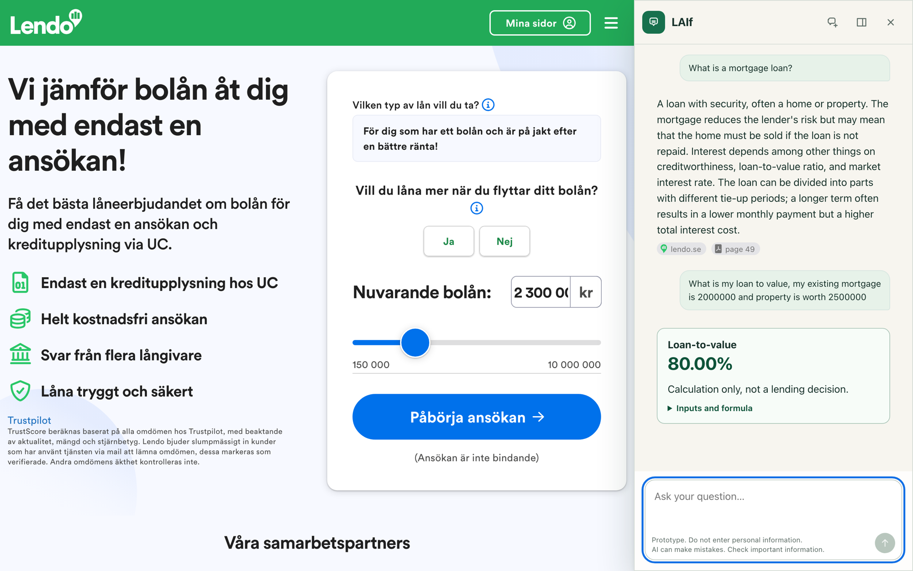
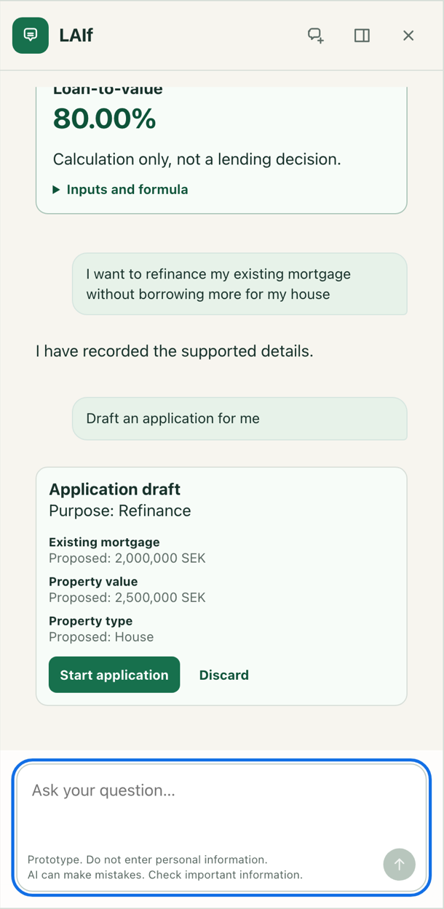
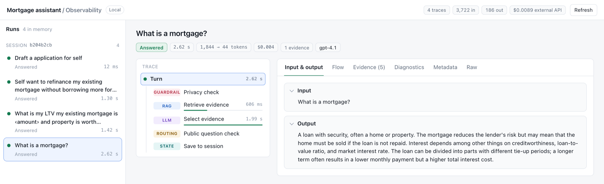

# Grounded Mortgage Assistant

A mortgage chat assistant that answers from reviewed, cited sources, calculates loan-to-value with a tool call, and turns a conversation into a pre-filled application draft. I built it as an AI Engineering capstone on the mortgage page of a Swedish loan comparison company.



*The assistant in the sidebar of the company's mortgage page. The website is proprietary and not part of this repository; this repository holds the backend, the engineering console and the documentation.*

Demo video (3:32): [youtu.be/u2Up18d1_OE](https://youtu.be/u2Up18d1_OE). Interactive architecture: [overview](https://kapilashrami.github.io/grounded-mortgage-assistant/architecture/overview.html) and [detailed view](https://kapilashrami.github.io/grounded-mortgage-assistant/architecture/detailed.html).

## What it does



- Answers product questions only from reviewed records. Retrieval uses two BGE-M3/FAISS views and a local reranker, and a relevance threshold decides whether the records cover the question at all. The LLM picks which records to cite, and the server shows their reviewed text with sources.
- Handles mortgage turns with a schema-validated tool call. Python calculates loan-to-value on the amounts the customer typed, so the model never does the arithmetic.
- Prepares an application draft only when the customer asks for one. One click fills the editable form, and nothing is submitted.
- Checks every message for personal data locally before any model sees it, and masks the amounts.
- Traces every turn in an engineering console, with tokens, latency and cost per step.
- Runs on a local Qwen model or on OpenAI (`gpt-4.1` by default), chosen at startup.

<br clear="right">



*The engineering console shows each step of a turn with its tokens, latency and cost.*

## Install

You need Python 3.14.

```sh
git clone https://github.com/kapilashrami/grounded-mortgage-assistant.git
cd grounded-mortgage-assistant
python3.14 -m venv .venv
.venv/bin/python -m pip install -r requirements.lock
.venv/bin/python -m pytest -q
```

The tests need no corpus and no model. Running the backend needs both, plus the local PII detector; [docs/setup.md](docs/setup.md) covers the settings and how to build a bundle from the sample records.

## Documentation

- [Architecture](docs/architecture.md): how a message moves through the system, with the source map.
- [Technical documentation](docs/technical-documentation.md): problem, retrieval, workflow, evaluation and limits.
- [Evaluation](docs/evaluation.md): every study with its numbers. Per-case outcomes are in [docs/results](docs/results).
- [Setup](docs/setup.md): settings, running the backend and the corpus.

## Results

On development cases, the relevance threshold of 0.23 keeps 142 of 146 answerable questions and rejects 7 of 9 that the records can't answer. In the real website, the full journey passes 16 of 16 checks and a set of 20 questions passes 19, on both local Qwen and GPT-4.1. The local reranker stayed after a comparison with Cohere, which gained a few cases and lost others. The LLM-as-a-judge run stopped at my OpenAI spend limit after 305 of 549 answers, so it can't name a winner yet; I'll finish grading the rest with the same judge. Details are in [docs/evaluation.md](docs/evaluation.md).

## Failure analysis

- Letting the model decide when to retrieve meant it sometimes skipped retrieval, so the service now always runs it.
- Free-form answers didn't stay close enough to the sources, so knowledge answers show the selected reviewed text instead.
- Facts and drafts shared one state, and an amount correction could start a draft. They now have separate lifecycles, and a draft needs an explicit request.
- Final testing found eight more defects, each reproduced in the browser and fixed with a test. One example: 58 of the 1,476 records had no citable source link, and an answer that picked one failed.

The full list is in [docs/evaluation.md](docs/evaluation.md#failures-and-pivots).

## Provenance

This history is a curated re-creation. I built the project in October 2026 in a private repository that also held company-owned content, which I can't publish, and assembled these commits from its final state in dependency order. The website frontend and the corpus belong to the company and are not included; published results are counts and case IDs only. The company agreed to publishing the code.

## License

[MIT](LICENSE), for the code. It gives no rights to the company's content, brand or website.
