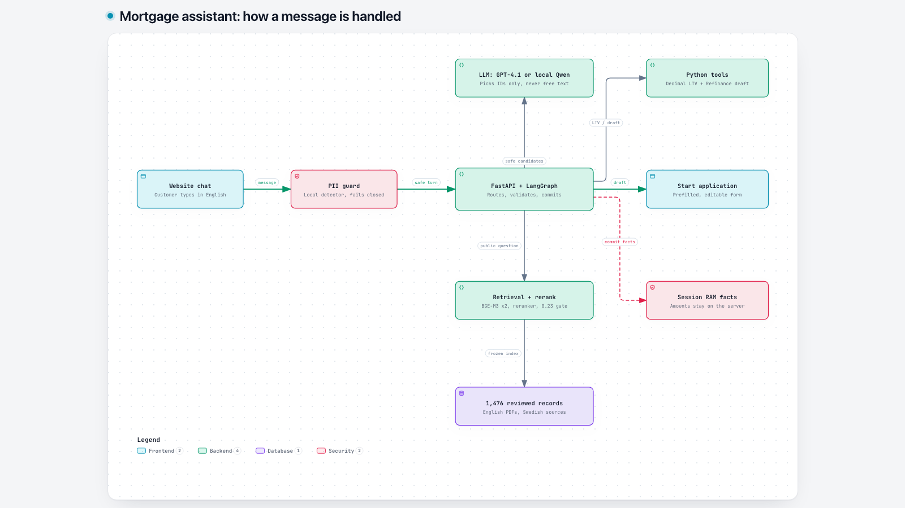
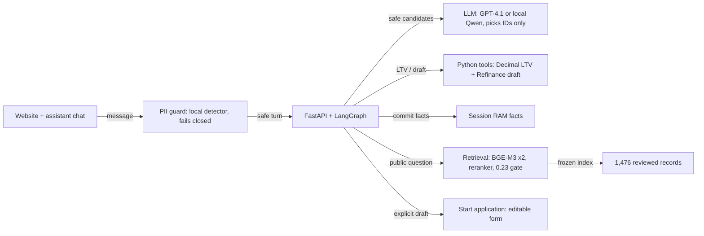
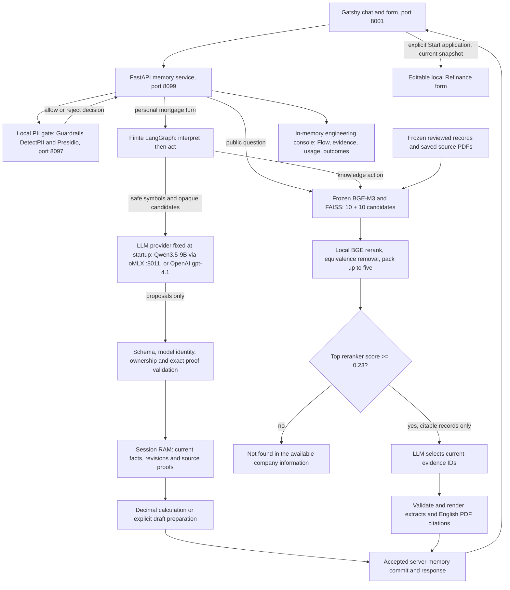

# Architecture

Two interactive diagrams go with this page: the [overview](architecture/overview.html) shows how one message is handled, and the [detailed view](architecture/detailed.html) accompanies the [technical documentation](technical-documentation.md). Open them in a browser, or view them live at <https://kapilashrami.github.io/grounded-mortgage-assistant/architecture/overview.html> and <https://kapilashrami.github.io/grounded-mortgage-assistant/architecture/detailed.html>.

## Overview

The service owns state, validation and tool execution. Every message passes the local PII guard first. Product questions go straight to retrieval. A reranker relevance gate decides whether the corpus covers the question, and the model only picks evidence IDs from citable records. On mortgage turns the model proposes from safe candidates, then Python validates the proposal, stores facts in session RAM and calculates LTV. The explicit draft request and the **Start application** action lead to the editable Refinance form shown in the demo video.

The recording uses OpenAI `gpt-4.1`. Local Qwen is the default and uses the same interface, with no fallback between them. In OpenAI mode only safe symbols, masked amounts and public evidence text leave the machine. No application submission, BankID, credit check or analytics operation is available.

The diagrams map which part of the implementation is responsible for what. They do not certify a deployment or measure model quality.

## Detailed view

This map covers the runtime and the demonstrated Refinance handoff.

### Ownership and boundaries

The API factory is `grounded_mortgage_assistant.app:create_app`. `LLM_PROVIDER` selects local Qwen (default) or OpenAI once at startup. Startup verifies the pinned local model and capacity, or checks that the OpenAI key can see the configured model, then loads the local tokenizer and frozen retriever. There is no fallback between providers, and both pass the same request, response and model-identity checks.

Public questions go straight to retrieval without personal interpretation. A reranker gate of 0.23, calibrated on the audited English cases, decides coverage before any model call. Personal turns pass through restricted-English ingress and a finite graph. The model proposes candidate selections, and only validated proposals can update current facts. Original values and exact proof spans stay private in session RAM. Safe context and complete optional exchanges have their own token budgets, separate from the evidence character budget.

The PII client calls a separate loopback detector and accepts only its boolean decision. If the detector fails, new processing is blocked. A disposable copy of the detector input can mask recognized financial spans using existing source proofs; the customer's original request and financial state stay unchanged. The detector environment has its own locked dependencies and local language assets.

The [final UI check](evaluation.md#failures-and-pivots) recorded six rejected synthetic PII cases with an empty trace question and answer and zero model tokens, rejection during a detector outage with recovery on retry, and reset during pending inference. Trace questions use corpus-owned public text or canonical symbols, with amount handles replaced by `AMOUNT`. Flow-answer traces keep the fixed server question label instead of the submitted text. The structured-answer and Forget paths were reviewed in source only, since the chat-first UI does not expose those controls.

Retrieval reads hash-checked local indexes and projections. It does not crawl sources or contact a production data service. Records without a citable source URL (58 of 1,476) are removed before selection. The model selects packed evidence IDs, then the server verifies and renders the saved extracts. English citation PDFs are hash-bound derivatives of the reviewed corpus and keep the original Swedish provenance. A source capture can be dated or limited in scope.

Financial tools use current proven inputs. Drafts have their own snapshot, revision and lifetime, and the browser owns visible form edits. On the local Refinance path, **Start application** checks the current draft and form snapshot before filling the supported step-1 fields, so an old card cannot overwrite a changed form. The flow stays editable and cannot submit. Only the Refinance draft is supported, and amounts and intent are typed in chat, with no guided question buttons.

The same backend serves the console. It shows safe execution projections and stopping reasons, keeps a bounded amount in memory and purges it with the session lifecycle. Its trace leaves out some retrieval candidates, reranker scores and exact model arguments, so it cannot prove a full pipeline replay.

## Source map

| Runtime responsibility | Implementation |
| --- | --- |
| API routes, lifecycle, public route and console | [app.py](../src/grounded_mortgage_assistant/app.py), [contracts.py](../src/grounded_mortgage_assistant/contracts.py), [console/](../src/grounded_mortgage_assistant/console/static/inspect.js) |
| Guardrail: private ingress and local PII detector | [guardrails/privacy.py](../src/grounded_mortgage_assistant/guardrails/privacy.py), [guardrails/pii.py](../src/grounded_mortgage_assistant/guardrails/pii.py), [detector service](../services/pii/app.py) |
| Workflow: finite interpretation/action graph | [workflow/graph.py](../src/grounded_mortgage_assistant/workflow/graph.py) |
| LLM: provider selection, model identity, candidate contract and safe context | [llm/conversation.py](../src/grounded_mortgage_assistant/llm/conversation.py), [llm/interpretation_candidates.py](../src/grounded_mortgage_assistant/llm/interpretation_candidates.py), [llm/model_context.py](../src/grounded_mortgage_assistant/llm/model_context.py) |
| RAG: public question routing, frozen retrieval, relevance gate, extract rendering and PDF provenance | [rag/public_questions.py](../src/grounded_mortgage_assistant/rag/public_questions.py), [rag/retrieval.py](../src/grounded_mortgage_assistant/rag/retrieval.py), [rag/answer.py](../src/grounded_mortgage_assistant/rag/answer.py), [rag/public_evidence.py](../src/grounded_mortgage_assistant/rag/public_evidence.py) |
| State: current facts, provenance, replay, reset and expiry | [state/memory.py](../src/grounded_mortgage_assistant/state/memory.py), [state/proofs.py](../src/grounded_mortgage_assistant/state/proofs.py), [state/runtime.py](../src/grounded_mortgage_assistant/state/runtime.py) |
| Tools: LTV calculation and Refinance draft building | [tools/calculations.py](../src/grounded_mortgage_assistant/tools/calculations.py), [tools/draft.py](../src/grounded_mortgage_assistant/tools/draft.py), [tools/schemas.py](../src/grounded_mortgage_assistant/tools/schemas.py) |
| Console trace events | [tracing.py](../src/grounded_mortgage_assistant/tracing.py) |
| Customer chat and direct handoff | Proprietary website frontend, not in this repository |

The source links point at the inspected implementation, and the final UI check recorded source hashes for the verified safety changes. The diagrams carry no committed-repository verification badge because the local repository they were made in had no origin remote. Automated diagram checks validate the artifact and browser layout, not runtime behavior. The [README](../README.md) links the results and the demo video.
