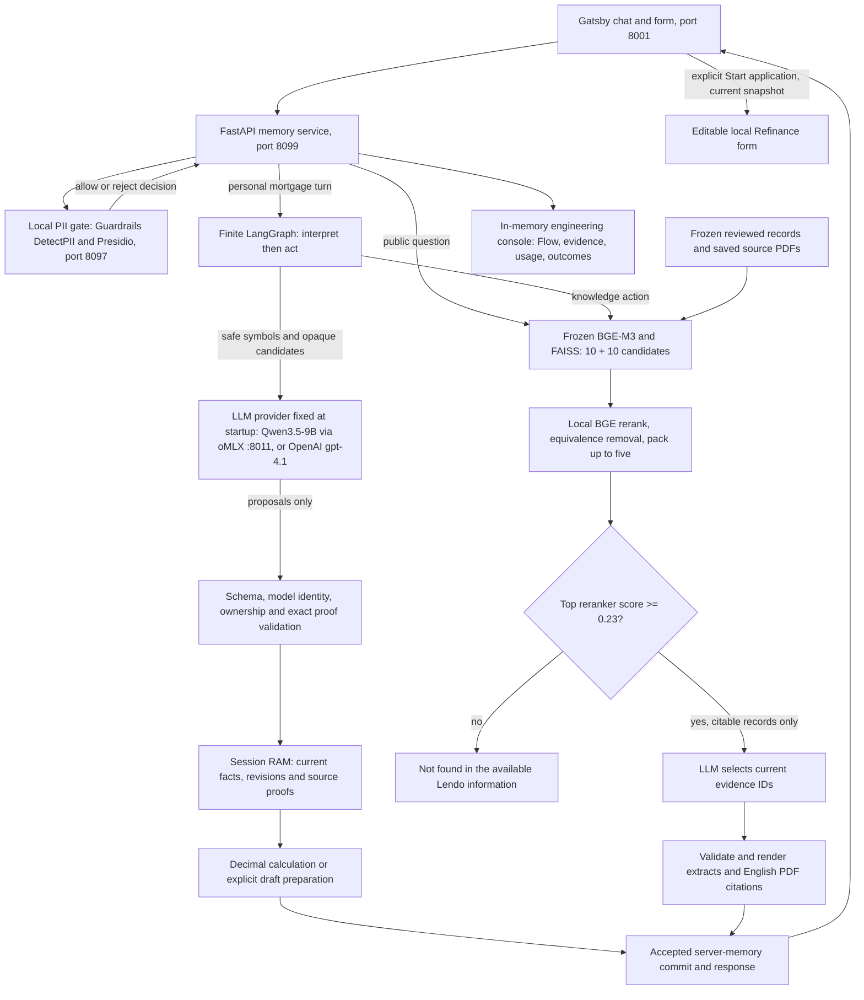

# Detailed architecture

The [interactive diagram](detailed.html) accompanies the [technical documentation](../technical-documentation.md). This map describes the runtime and the demonstrated Refinance handoff.

## Ownership and boundaries

The API factory is `grounded_mortgage_assistant.app:create_app`. `LLM_PROVIDER` selects local Qwen (default) or OpenAI once at startup. Startup verifies the pinned local model and capacity, or that the OpenAI key can see the configured model, then loads the local tokenizer and frozen retriever. There is no fallback between providers, and both pass the same request, response and model-identity checks.

Public questions go straight to retrieval without personal interpretation; a reranker gate of 0.23, calibrated on the audited English cases, decides coverage before any model call. Personal turns pass through restricted-English ingress and a finite graph. The model proposes candidate selections; only validated proposals can update current facts. Original values and exact proof spans remain private in session RAM. Safe context and complete optional exchanges are token-budgeted independently of the evidence character budget.

The PII client calls a separate loopback detector and accepts only its boolean decision. Detector failure blocks new processing. A disposable detector string can mask recognized financial spans using existing source proofs; this does not change the customer's original request or financial state. The detector environment has separately locked dependencies and local language assets.

The [current UI receipt](../experiments/failures-and-pivots.md) records six rejected synthetic PII cases with empty trace question/answer and zero model tokens, detector-outage rejection/retry recovery, and reset during pending inference. Trace questions use corpus-owned public text or canonical symbols with amount handles replaced by `AMOUNT`. Flow-answer traces keep the fixed server question label, not submitted text. Structured-answer and Forget paths were source-reviewed; the chat-first UI does not expose those controls.

Retrieval reads hash-checked local indexes and projections. It does not crawl sources or contact a production data service. Records without a citable source URL (58 of 1,476) are removed before selection. The model selects packed evidence IDs, then the server verifies and renders the saved extracts. English citation PDFs are hash-bound derivatives of the reviewed corpus and retain original Swedish provenance. A source capture can be dated or limited in scope.

Financial tools use current proven inputs. Drafts have their own snapshot, revision and lifetime. The browser owns visible form edits. For the local Refinance path, **Start application** checks the current draft and form snapshot before filling the supported step-1 fields. A changed form must not be overwritten by an old card. The flow remains editable and cannot submit. Only the Refinance draft is supported; amounts and intent are typed in chat, with no guided question buttons.

The console is served by the same backend. It exposes safe execution projections and stopping reasons, with bounded in-memory retention and session lifecycle purging. Its trace does not contain every retrieval candidate, reranker score or exact model argument, so it cannot prove full pipeline replay.

## Source map

| Runtime responsibility | Implementation |
| --- | --- |
| API routes, lifecycle, public route and console | [app.py](../../src/grounded_mortgage_assistant/app.py), [contracts.py](../../src/grounded_mortgage_assistant/contracts.py), [console/](../../src/grounded_mortgage_assistant/console/static/inspect.js) |
| Guardrail: private ingress and local PII detector | [guardrails/privacy.py](../../src/grounded_mortgage_assistant/guardrails/privacy.py), [guardrails/pii.py](../../src/grounded_mortgage_assistant/guardrails/pii.py), [detector service](../../services/pii/app.py) |
| Workflow: finite interpretation/action graph | [workflow/graph.py](../../src/grounded_mortgage_assistant/workflow/graph.py) |
| LLM: provider selection, model identity, candidate contract and safe context | [llm/conversation.py](../../src/grounded_mortgage_assistant/llm/conversation.py), [llm/interpretation_candidates.py](../../src/grounded_mortgage_assistant/llm/interpretation_candidates.py), [llm/model_context.py](../../src/grounded_mortgage_assistant/llm/model_context.py) |
| RAG: public question routing, frozen retrieval, relevance gate, extract rendering and PDF provenance | [rag/public_questions.py](../../src/grounded_mortgage_assistant/rag/public_questions.py), [rag/retrieval.py](../../src/grounded_mortgage_assistant/rag/retrieval.py), [rag/answer.py](../../src/grounded_mortgage_assistant/rag/answer.py), [rag/public_evidence.py](../../src/grounded_mortgage_assistant/rag/public_evidence.py) |
| State: current facts, provenance, replay, reset and expiry | [state/memory.py](../../src/grounded_mortgage_assistant/state/memory.py), [state/proofs.py](../../src/grounded_mortgage_assistant/state/proofs.py), [state/runtime.py](../../src/grounded_mortgage_assistant/state/runtime.py) |
| Tools: LTV calculation and Refinance draft building | [tools/calculations.py](../../src/grounded_mortgage_assistant/tools/calculations.py), [tools/draft.py](../../src/grounded_mortgage_assistant/tools/draft.py), [tools/schemas.py](../../src/grounded_mortgage_assistant/tools/schemas.py) |
| Console trace events | [tracing.py](../../src/grounded_mortgage_assistant/tracing.py) |
| Customer chat and direct handoff | Proprietary frontend (not in this repository): `apps/landing/src/components/LAIfChat/LAIfChat.tsx` and `MortgageDraftContext.tsx` |

Source links describe the inspected implementation; the current UI receipt records source hashes for the verified safety changes. The diagrams deliberately carry no committed-repository verification badge because this local repository has no origin remote. Automated diagram checks validate the artifact and browser layout, not runtime behavior. The [README](../../README.md) links the results and the demo video.
