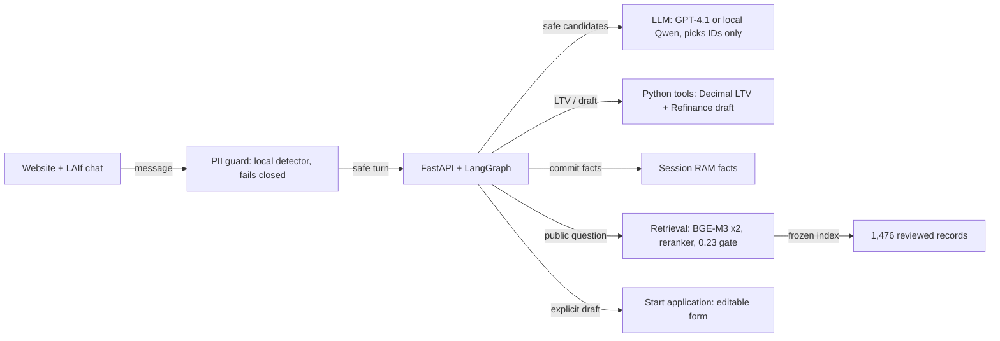

# Architecture overview

The [interactive diagram](overview.html) shows how one message is handled; open it in a browser.

The service owns state, validation and tool execution. Every message passes the local PII guard first. Product questions go straight to retrieval; a reranker relevance gate decides whether the corpus covers the question, and the model only picks evidence IDs from citable records. Mortgage turns let the model propose from safe candidates, then Python validates the proposal, stores facts in session RAM and calculates LTV. The explicit draft request and **Start application** action lead to the editable Refinance form shown in the demo video.

The recording uses OpenAI `gpt-4.1`; local Qwen is the default and uses the same interface, with no fallback between them. In OpenAI mode only safe symbols, masked amounts and public evidence text leave the machine. No application submission, BankID, credit check or analytics operation is available.

This is a responsibility map of the implementation, with source references in the [detailed architecture](detailed.md). It is not a deployment certification or a model-quality result.
